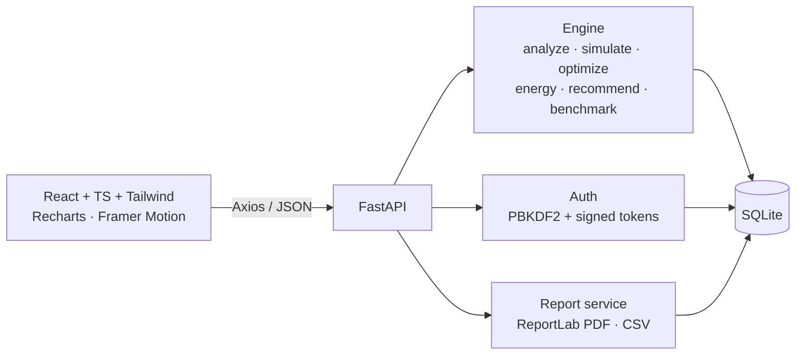

# Architecture

**Engine model.** Latency = GFLOPs / sustained device GFLOPs (+ fixed overhead). Memory = 1.3 x model size + activation estimate.
Optimization methods apply multiplicative factors to size, latency, memory and power and subtract an accuracy penalty.
All numbers are first-order estimates; edit `backend/services/engine.py` (`MODELS`, `DEVICES`, `OPT`) to calibrate with your own measurements.
